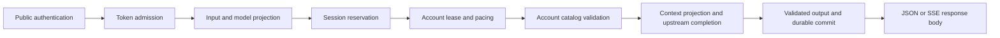

# Developer guide

[中文](DEVELOPMENT_ZH.md) · English · [Documentation index](DOCS.md)

This guide describes **v0.1.0-alpha.4** as implemented in this repository. Start
with [installation](DEPLOY_EN.md) and the [public API](API.md) if you only need to
run the service. Interface details live in the linked reference documents; this
guide explains ownership, invariants and how to change the implementation safely.

## 1. Scope and current boundaries

Claud2Api is a Rust HTTP service with an embedded administration console. Its
primary interface is an Anthropic-shaped Messages text/client-tool bridge. The
upstream is a web conversation service, so an accepted API field does not imply
the corresponding native API capability.

- Messages supports JSON/SSE, validated client tools, durable sticky sessions,
  quota-aware migration and local context compaction.
- Chat Completions and Responses retain separate **text compatibility** paths.
  They do not implement the complete OpenAI protocols or inherit all Messages
  session/compaction/migration behavior.
- Models come from the selected account's catalog. New native IDs do not require
  a hardcoded model-family allowlist. An unknown price does not block generation.
- Token counts, one-hour cache metrics and USD costs are local estimates.
  Remaining provider allowance is unknown.
- Browser presets emulate network behavior. They are not complete browsers and
  provide no guarantee against access challenges or account restrictions.
- The verified release platform is Linux AMD64. Other platforms require their
  own build and runtime acceptance before being advertised as supported.

## 2. Repository map

| Path | Responsibility |
|---|---|
| [src/main.rs](src/main.rs) | Supervisor/worker entry, header timeout, worker janitor and shutdown |
| [src/updates/](src/updates/) | Fixed ingress, release checks, verified downloads, worker switching and backup recovery |
| [src/lib.rs](src/lib.rs) | Module exports and Cargo-derived product version |
| [src/config.rs](src/config.rs) | Startup configuration, credentials and validated runtime settings |
| [src/web.rs](src/web.rs) | Public authentication, response lifetime, Messages JSON/SSE |
| [src/protocol.rs](src/protocol.rs) | Input projection, transcript/tool validation, identities and tool-frame decoding |
| [src/models.rs](src/models.rs) | Published model IDs, exact aliases and native resolution |
| [src/tokens.rs](src/tokens.rs) | Managed credentials, digests and token admission |
| [src/guard.rs](src/guard.rs) | Request cancellation/deadlines, account pool and single-account leases |
| [src/engine.rs](src/engine.rs) | Session reservation/ownership, migration, summaries and cleanup |
| [src/turn.rs](src/turn.rs) | One generation attempt, context projection and successful state commit |
| [src/transport.rs](src/transport.rs) | Upstream HTTP, model observation and SSE reading |
| [src/browser.rs](src/browser.rs) | Supported browser bundles and account proxy validation |
| [src/store.rs](src/store.rs) | Encrypted snapshot, SQLite transactions, migrations and durable records |
| [src/observability.rs](src/observability.rs) | Request spans, terminal status and per-attempt Token counters |
| [src/usage.rs](src/usage.rs) | Estimated usage, frozen rate quotes and analytics windows |
| [src/control.rs](src/control.rs) | Administrator and restricted Bot information endpoints |
| [src/compat.rs](src/compat.rs) | Separate Chat/Responses/conversation-delete compatibility routes |
| [src/error.rs](src/error.rs) | Sanitized structured failures |
| [Dockerfile](Dockerfile) | Build an image from source |
| [Dockerfile.release](Dockerfile.release) | Package the verified Release binary in the published image |
| [.github/workflows/release.yml](.github/workflows/release.yml) | Version checks, GHCR publication and complete Release assets |
| [scripts/package_release.py](scripts/package_release.py) | Binary, update manifest, license archive and checksums |
| [scripts/container_acceptance.py](scripts/container_acceptance.py) | Verify the final image with synthetic keys and disposable state |
| [ui/](ui/) | Embedded HTML/CSS, application state, charts, uniform selects and Logo |
| [tests/](tests/) | Protocol, configuration and mock-upstream integration regressions |
| [scripts/](scripts/) | Key generation, license inventory, release packaging and update acceptance |
| [LICENSES/dependencies/index.json](LICENSES/dependencies/index.json) | Locked package provenance, notices and checksums |

The console uses plain DOM JavaScript. There is no separate frontend package
installation or bundler. Rust `include_str!` embeds its files; rebuild the binary
or image after changing UI assets. Preserve persisted encryption domains and
state fingerprints when changing request adapters.

## 3. Local development

### Toolchain

Cargo declares Rust **1.98** as its minimum; release acceptance used **1.99.1**.
The manifest alone does not demonstrate acceptance of every lower toolchain.
Install C/C++ build tools, CMake, Perl, pkg-config and libclang for the native
transport dependencies. The Dockerfile and CI contain the pinned Linux build base.

```sh
sudo apt-get update
sudo apt-get install -y build-essential cmake perl pkg-config libclang-dev
rustup component add rustfmt clippy
cargo build --locked
```

Keep `Cargo.lock` and the pinned Git dependency revisions. A different source
tree with the same package version is not an equivalent dependency replacement.
On Windows, use a Linux Docker environment or a Linux development environment
for the documented release path.

### Start an isolated empty instance

Run the following from the repository root in a dedicated POSIX shell. It creates
fresh keys and state outside the repository and imports no real account. It is
useful for console work; generation needs a separately configured mock or an
explicitly authorized account.

```sh
DEV_PRIVATE="$(mktemp -d "${TMPDIR:-/tmp}/claud2api-dev.XXXXXX")"
chmod 700 "$DEV_PRIVATE"
python3 scripts/generate_key.py "$DEV_PRIVATE/gateway-key.txt"
python3 scripts/generate_key.py "$DEV_PRIVATE/admin-key.txt"
touch "$DEV_PRIVATE/accounts.txt"
chmod 600 "$DEV_PRIVATE/accounts.txt"
mkdir -m 700 "$DEV_PRIVATE/state"
unset CLAUDE_SESSION_FILE CLAUDE_COOKIE CLAUDE_SESSION_KEY STICKY_SESSION_STATE_FILE BOT_READ_KEY BOT_READ_KEY_FILE
export GATEWAY_API_KEY_FILE="$DEV_PRIVATE/gateway-key.txt"
export ADMIN_API_KEY_FILE="$DEV_PRIVATE/admin-key.txt"
export CLAUDE_ACCOUNTS_FILE="$DEV_PRIVATE/accounts.txt"
export CLAUD2API_DATA_DIR="$DEV_PRIVATE/state"
export BIND_HOST=127.0.0.1 PORT=18081 CONTROL_BIND=127.0.0.1:18082
cargo run --locked
```

Open `http://127.0.0.1:18082/` and use the new admin key. In another shell,
`curl http://127.0.0.1:18081/health` checks local state health. An empty account
pool may still be healthy; health is not a provider-login or model-availability
test. Keep real account files, databases, screenshots and test reports outside
the source distribution. Do not point this instance at production state.

## 4. Request flow and ownership



Read `web::messages`, `Engine::reserve_owned`, `Engine::run`, `turn::attempt`
and `Store::mutate` together when changing this path. Session ownership uses an
active ticket so an old cancellation task cannot overwrite a newer reservation.
Upstream readers, cancellation and body delivery remain part of the lifecycle;
returning response headers is not completion.

| Resource | Required lifetime |
|---|---|
| Managed-token permit | Through response-body completion or drop, including unread JSON/SSE |
| Account lease | Through upstream work, reader termination and bounded cleanup |
| Session owner | Through commit or cancellation cleanup, with active-ticket checks |
| Selected model/config | Captured for the admitted request; later edits do not rename its response |

All public compatibility routes share authentication and account guards. The
environment gateway key has its own session namespace and no extra managed-token
semaphore; it still obeys account and pool limits.

## 5. Scheduling, cancellation and failure

Each account has one reused `Semaphore(1)`. Duplicate Cookie variants with the
same Session Key share its account identity. Global or token limits cannot raise
this cap. Different sessions can bind to one account without reserving an idle
request slot. Busy ordinary requests return 429; they do not move a bound
conversation simply to obtain a free account.

Default start pacing is five seconds and six requests per rolling minute. Model
queries and remote cleanup also use account admission. The account's pause,
cooldown and pacing state survive restart. A separate instance or interactive
browser does not share this in-process account lock.

`Scope::wait` observes cancellation and a deadline. Dropping a response body
cancels its work. Stop/join readers before releasing account capacity; preserve
uncertain remote ownership as pending cleanup rather than pretending the request
never reached upstream. The janitor runs every 15 seconds. Shutdown stops the
listeners and janitor with bounded waits and flushes status records.

| Condition | Required behavior |
|---|---|
| Invalid input or unavailable/unpublished model | 400 before generation |
| Invalid/expired/deleted API token | 401; no provider request |
| Another token's opaque session handle | 403; no history reuse |
| Stale revision or busy transport edit | 409; retain current configuration |
| Busy/token/pacing limit | 429 with bounded retry metadata |
| Explicit upstream quota rejection before generation | Apply cooldown; Messages may migrate |
| Authentication/access challenge | Pause account; require operator review |
| Partial output, transport failure or uncertain generation | Do not transparently replay |
| Unhealthy snapshot persistence | Block new account work; do not overwrite state |

Respect valid `Retry-After`. The default 18000-second fallback is a conservative
local cooldown when reset timing is missing, not evidence of the provider's
actual five-hour reset. The entire pool can still be unavailable. Never promise
unconditional uninterrupted generation.

## 6. Sessions, migration and context

Messages separates three states: durable logical session identity, the current
physical web conversation/parent, and an optional protected summary checkpoint.
See [sticky sessions](STICKY_SESSIONS.md) and [context management](CONTEXT_MANAGEMENT.md).

- Supported explicit identifiers take precedence; otherwise reuse requires one
  unambiguous exact completed-history prefix. System text or first-user text is
  not sufficient identity. Managed-token namespaces remain isolated.
- Clients continue to send their full supported history. A verified continuation
  sends only new turns upstream. A successful commit refreshes the session TTL
  (default 3600 seconds); failed reservations do not extend it. Active work cannot
  be expired by the janitor.
- Changing model/system/tools or editing the verified prefix can reset the
  physical conversation. Queue deletion of owned old IDs under their original
  account. Never reuse another account's web ID or parent UUID.
- Explicit pre-generation quota failure can create a new physical conversation
  on another eligible account. A usable checkpoint plus uncovered history is
  preferred; otherwise rebuild from complete supported history. Try each account
  at most once per request. Commit the replacement only after success.
- If an operator disables the bound account between turns, the next request can
  also choose another eligible account; admitted work drains. An access pause is
  different from operator disablement and cannot be bypassed through migration.
- A busy migration destination can be awaited within the request deadline.
  Streaming waits may send pings, never invented assistant text. Disconnect
  cancels the wait. Partial or uncertain output never enters this replay path.
- Compaction preserves original system/tool definitions, current input and recent
  complete text/tool units. Its default trigger is 75% of a conservative 128000-unit
  physical budget, keeping six recent units. A tool call/result pair cannot be
  split across the cut.
- Internal summarization is another admitted generation. Validate its strict
  JSON, bounded size, prefix HMAC and meaningful reduction before keeping a
  checkpoint. It consumes capacity and can be lossy. Invalid summaries retain the
  source and back off; they must not appear in the business response.

Messages' durable sessions differ from Chat/Responses' process-local
`conversation_id` map. Legacy maps are owner-scoped and handed off in memory
during managed upgrades and rollback. They do not survive an ordinary restart
or hard crash, and do not use Messages compaction or transparent quota migration.

## 7. Persistence and secret boundaries

`Store::mutate` clones the snapshot, applies a checked change, serializes and
encrypts it, commits the vault and optional audit event in one SQLite transaction,
then publishes the new in-memory snapshot. Preserve this order. Failed writes
must not leave memory claiming an uncommitted configuration or session.

The snapshot uses authenticated AES-256-GCM with a key derived from the gateway
key, a random nonce and a versioned domain/AAD. SQLite also contains metadata
tables for events, usage and status logs; **the entire database is not encrypted**.
Never put credentials, prompts, tool arguments/results or summary text into those
metadata rows. The encrypted snapshot does contain account credentials, proxy
secrets and bounded handoff summaries, so backups remain sensitive.

On Linux, protect the state directory with 0700 and database/lock files with
0600. The store uses an exclusive instance lock and SQLite WAL/FULL settings.
Back up the whole state directory with the matching gateway key while stopped.
Changing that key directly breaks decryption; managed-token revocation does not
require key rotation.

Preserve authenticated old-format decoding and optional one-time version1 JSON
import. Restore checks retire uncertain sessions and retain cleanup obligations.
Corrupt state or a wrong key fails closed. Do not replace an unreadable database
with an empty one or run old and new instances against the same real accounts.

## 8. Models, tools and upstream transport

Model configuration resolves an exact published ID before one-time `c2a-`
normalization. An exact disabled entry must reject; it cannot fall through to a
native alias. Resolve the native target and validate it against the executing
account. In configured mode all response presentations retain the captured
published ID. `/v1/models` reflects one selected account, not a union of pool
permissions. See the [control API](CONTROL_API_EN.md).

Explicit administrator catalog fetch uses the account's existing guard, profile
and proxy with a maximum eight-second wait. Read-only configuration polling is
local. Fetching records an observation without changing mappings or their
revision; the UI merges missing entries into an unsaved draft. Saving is separate.

Client tools are encoded in a nonce-delimited text protocol and validated against
the declared schemas. Native upstream tools are disabled on the Messages bridge.
The gateway executes no tools and fabricates no results. Ignore unsupported
optional controls only at their declared boundary: a `thinking` key inside tool
input is business data. Do not recursively strip it. Remote/file schema loading
is disabled. New block types need explicit protocol support, not a generic cast.

Profiles are the exact supported `wreq`/`wreq-util` bundles: Chrome Windows 146–152
and Firefox Windows 144–151. A profile change requires an idle account and preserves
its identity, original semaphore, session/checkpoint/cache state and revision
checks. Extend profiles only when the pinned library actually supports them.

Account proxies cover upstream requests and responses. Disable ambient proxies,
then apply the explicit HTTP/HTTPS/SOCKS5/SOCKS5H URL. Validate it without echoing
credentials; expose only a sanitized summary. `socks5` resolves locally,
`socks5h` remotely. Upstream API redirects/challenges are not login recovery.

## 9. Usage, simulated cache and logs

Keep these ledgers distinct:

| Measurement | Basis and purpose |
|---|---|
| Logical API usage | Character-based estimate of the complete logical input/output |
| Physical context | Conservative UTF-8-byte-based estimate used for compaction |
| Upstream status usage | Per-attempt sent prompt and received output fragments |
| Simulated cache | Local logical-prefix partition; no observation of upstream KV cache |
| Simulated cost | Frozen native-model rates and categories on each usage row |

Simulated cache and sticky expiry both default to one hour but are independent
fields. Cache success extends `cache_until`; valid continuation reads require
enabled simulation, a matching prefix and an unexpired cache. Reset, migration
or compaction starts a fresh simulated creation. Never count full input and
cache categories twice. Toggle changes affect new records, not historical prices.
See [cache metrics](SIMULATED_CACHE.md) and [analytics](USAGE_ANALYTICS_EN.md).

Status records retain requested model, owner/name, account, direction, phase,
status, bytes/chunks and optional estimated Token counters. Downstream input
includes cache creation/read; successful output is published only after successful
body EOF. Upstream attempts count their own prompts and received text/thinking/
partial-JSON fragments. Unknown failure output is `null`; a successful empty
output may be zero. Partial output remains explicitly incomplete.

Status retention is bounded to 10000 records/seven days. The usage ledger is a
different table and is not truncated to that window. The separate Bot `/usage`
summary caps at 10000 rows and exposes `truncated`; `/analytics` is the full-ledger
path. Analytics uses configured
IANA calendar boundaries and frozen integer nanoUSD amounts. Missing prices or
old attribution remain unknown/unpriced, not free or reassigned. Logs contain no
chat content, secrets or summary text. Keep queue overflow and logging failures
observable without failing unrelated generation merely to preserve a log.

## 10. Console and Bot integration

The independent control listener is loopback-only. Administrator and optional Bot
keys are distinct from public credentials. Mutations use `expected_revision`,
except explicit catalog observation, which does not change configuration revision.
On 409, keep the user's draft and request a fresh review rather than overwriting
someone else's edit. Proxy credentials are write-only; API token plaintext appears
only in its creation response.

`ui/app.js` owns login/logout, tab rendering, serialized polling and dirty forms;
`ui/charts.js` owns analytics rendering; `ui/selects.js` owns uniform accessible
select popups. Polling defaults to 20 seconds after login. Preserve abort/epoch
guards, unsaved drafts, one-time token state, inherited CJK/Latin/numeric font and
dark-only styling. Avoid raw `innerHTML` for user-controlled data. Keep popups
within the viewport and remove observers for detached dynamic controls.

Future notification services can poll `/control/v1/info`, `/usage` and `/events`
with the optional Bot read key. It cannot read account administration, logs,
analytics, model configuration or tokens. Persist the event cursor and deduplicate
externally. There is no built-in push Bot or webhook delivery/retry guarantee in
this release. Do not expose the control port publicly to integrate one.

## 11. Verification

Run from the repository root in the documented Linux toolchain:

```sh
cargo fmt --all -- --check
cargo clippy --locked --all-targets -- -D warnings
cargo test --locked --all-targets
cargo build --locked --release
node --check ui/app.js
node --check ui/charts.js
node --check ui/selects.js
node --check ui/versions.js
python3 scripts/update_acceptance.py --artifacts /tmp/claud2api-update-acceptance --build
```

Node is needed for these syntax checks, not for the shipped runtime. Use the
current Cargo test report for test counts. The adapters are checked against
explicit input, output, error and usage requirements rather than old snapshots.

| Test area | Important assertions |
|---|---|
| [tests/protocol.rs](tests/protocol.rs) | State fingerprints, structured envelopes, system roles, tools/schema refs, fragmented SSE/tool frames and safe summary cuts |
| [tests/config.rs](tests/config.rs) | Invalid locale/control bind/import paths fail startup |
| [tests/browser.rs](tests/browser.rs) | Exact profile catalog and proxy validation |
| [tests/gateway.rs](tests/gateway.rs) | Account/token lifetime, JSON/SSE, model IDs/catalogs, cancellation, migration/compaction, state/restart, logs and analytics |
| [src/updates/](src/updates/) | SemVer, published assets, conditional requests/backoff, compatibility, database locks, backup recovery and installed history |
| [scripts/update_acceptance.py](scripts/update_acceptance.py) | Real worker upgrade/rollback, active SSE, preserved Messages/Chat bindings and data, failed candidates and restart |

Use local mock upstreams for deterministic failure, truncation, quota, timing and
cancellation cases. They do not need a real account. UI changes also require
desktop/narrow-browser checks: login, polling, dirty drafts, token secrecy,
connection recovery, select keyboard behavior, chart empty states and no overflow.

For a release, build the actual Dockerfile and test that image with a fake upstream:
non-root/read-only startup, loopback control separation, strict SDK JSON/SSE,
cache on/read/off, Token-log accounting, token scopes and forced-restart persistence.
The repository does not currently provide a single command for all SDK/browser
acceptance; record the actual harness, image ID and results separately. A real
provider test requires separate authorization and an isolated account. Production
accounts, other gateways and clients are not test fixtures.

## 12. Extension checklist

| Change | Files and checks to consider |
|---|---|
| New public field/block | `protocol.rs` projection/validation, `web.rs` serialization, tool semantics, safe diagnostics, JSON/SSE and both API languages |
| New model/alias behavior | `models.rs`, account catalog checks, all six response presentations, exact-disabled precedence |
| New browser profile | Pinned library support, `browser.rs` mapping, UA/Client Hints/TLS coherence, busy edits and state continuity |
| New persisted field | Serde defaults, load validation, transaction order, old vault/import tests, restart/corruption behavior |
| New pricing entry | Explicit native ID and dated source, `usage.rs`, tier/cache category math and unknown-price cases |
| New control operation | Scope, revision, validation, sanitized audit, UI draft/race handling and Bot exclusion |
| New log field | Per-attempt/request ownership, privacy, old-null compatibility, query filters and terminal delivery semantics |

Implement one contract owner and reuse it across routes. Add regression coverage
for the observable behavior and failure boundary. Do not silently expand API
claims just because an optional field is accepted.

## 13. Release and maintenance

1. Update Cargo version/lock entry, UI labels, README headers, changelogs and
   Compose image tag together. Runtime version derives from Cargo.
2. Complete scoped tests and final-image acceptance; record platform, toolchain,
   image/binary hashes and any unverified limits.
3. For dependency changes, run `cargo metadata --locked --format-version 1` and
   regenerate the inventory with `scripts/license_inventory.py` in an environment
   that can read those dependency source paths. Review changed notices/checksums.
4. Inspect the candidate source tree and Git state. Exclude credentials, runtime
   state, build output, screenshots and private reports. Retain MIT and all required
   third-party notices. Branch/PR CI verifies and builds artifacts. Pushing a
   matching version tag triggers the release workflow: verify draft assets, then
   publish. Neither workflow deploys production.
5. Use the [version manager](UPDATES.md) for compatible updates and rollback,
   preserving current data. A full image/schema migration needs a stopped-state
   backup plus the matching key and a separately verified recovery plan. Never
   clear cooldowns, discard unreadable state or restore a stale backup over new
   requests to make an upgrade appear successful.
6. Update both language versions and [the documentation index](DOCS.md). Keep
   existing filenames/links valid. Changes intended for review remain uncommitted
   until the agreed review/commit step is complete.

## 14. Troubleshooting by boundary

| Symptom | First evidence to inspect |
|---|---|
| Startup fails | Sanitized startup message, key separation, absolute state/import paths, lock, DB readability and native dependencies |
| Client receives 400 | Requested model and safe input diagnostic; distinguish discarded optional controls from invalid semantic data |
| 429 with idle-looking account | Token/global admission, per-account pacing, cooldown and the actual bound session |
| Account remains paused after restart | Persisted access pause; operator review and explicit resume, not process restart |
| SSE has HTTP 200 but fails | Terminal SSE event and matching upstream/downstream request IDs |
| Token counts differ | Logical input versus per-attempt prompt, cache category inclusion and complete/partial/null state |
| Historic cost changes unexpectedly | Frozen usage charge/mode, query window/timezone and any accidental repricing |
| Edited setting reverts/conflicts | Dirty-form state and shared revision, rather than another unsynchronized write |

Capture only allowlisted metadata and reproducible mock inputs. Never attach real
keys, Cookie headers, raw HAR files or private conversation content to an issue.

## Managed version changes

`src/updates/` owns release discovery, integrity checks, the single-writer worker
and SQLite backup/recovery. `ui/versions.js` owns the version dialog and reload
with an in-memory login handoff. See [the update guide](UPDATES.md) for usage;
the following sections cover development, publishing and recovery. Changes require
update integration acceptance plus protocol regressions.

### Release checks

The backend checks the public GitHub Releases catalog at startup and every 300
seconds. A connected panel reads update status every 300 seconds and polls progress
while a job is active. All panels share one backend catalog/check budget; opening
panels does not multiply GitHub polling. Manual checks are throttled to 30 seconds.
ETags avoid redundant catalog transfers. Network errors, missing releases and rate
limits leave the service running; retry headers defer checks for 5 minutes to one
day. No GitHub access token, gateway key or administrator key is sent to GitHub.

### Runtime and data continuity

On Linux AMD64 the executable starts a stable supervisor holding the public and
control ports. One managed child owns SQLite and the upstream conversations. UI
assets are embedded in each child. Updates replace that child using a verified
Linux executable; no shell, Git checkout, container socket or root privilege is
required. Downloading and waiting for an idle window leave ordinary traffic running.
In-flight HTTP/SSE responses retain their worker until they finish or disconnect.
After 30 minutes without an idle window the update fails and traffic continues.

At an idle window, the supervisor exports compatibility-session bindings in memory,
stops the old writer, creates a consistent SQLite backup, starts and health-checks
the candidate, imports the bindings and commits the selected version. Accounts,
names, proxies, token secrets/digests, saved settings, sticky sessions, checkpoints,
simulated cache, cooldowns, usage, events and message logs use the same state and
original encryption key. Rollback preserves the current data; it does not rewind
usage to an old release's backup. Failed startup restores the just-taken backup and
restarts the original version. A durable journal handles interruption during a
switch; child stdin EOF prevents an orphan writer after supervisor termination.
Hard process/host crashes can still lose transient compatibility bindings, as with
an ordinary restart; durable Messages sessions remain in SQLite.

New requests briefly queue during stop/backup/start; this is not a promise of zero
latency. The queue holds up to 256 proxied responses, waits up to 60 seconds, and
then returns 503 rather than hanging indefinitely. Keep the entire state directory
on a writable filesystem that permits executable files (not a `noexec` mount),
owned by the service user. Reserve space for three installed binaries, two full
database backups and a staged download. Runtime binaries are capped at 128 MiB.
The container's read-only root and `/tmp` with `noexec` remain supported.

### Release source and compatibility

Default source: `Saito-Sakuya/Claud2Api`. Optional startup settings:

| Variable | Default | Meaning |
|---|---|---|
| `CLAUD2API_UPDATE_REPOSITORY` | `Saito-Sakuya/Claud2Api` | Trusted public owner/repo; changing it changes who can supply executable code |
| `CLAUD2API_UPDATE_DISABLED` | `false` | Set exactly `true` to disable checks and managed switches |

Compose forwards both variables. Private repositories are not supported. Only
published, complete releases with valid SemVer tags and both verified assets are
offered. Stable installations exclude prerelease updates; prerelease installations
may update to newer prerelease or stable versions. Rollback offers the two nearest
lower published versions, if present. A deleted, incompatible or unavailable asset
can still make a listed choice fail safely when applied. At most 500 catalog entries
are inspected; the dialog indicates truncated history.

Required assets are `claud2api-linux-amd64` and `claud2api-update.json`. The manifest
binds version, protocol, runtime ABI, data format, size and SHA-256. The updater
also verifies GitHub's asset digests, download size, trusted HTTPS redirect hosts,
ELF architecture and the binary's own build descriptor. These integrity checks
trust the configured repository; they are not independent publisher signatures.
Current protocol is 1, runtime ABI `linux-amd64-glibc-2.36`, data format
`sqlite-v1/Claud2Api-vault-v1`. Automatic schema/ABI/protocol migration is refused.
For such changes replace the full container/base executable using a separately
verified migration and backup plan. The supervisor itself remains at its original
version; the dialog/API reports both supervisor and running worker versions.

Selected binaries and the last two installed binaries live under
`updates/versions/`; selection survives container restart/recreation with the
same volume. Cached installation history is separate from the two published
rollback choices. Restarting an older image does not override a saved selection.
For manual recovery, stop the instance, back up the entire state plus matching
key/config, remove only `updates/`, and start the intended compatible base image.
Never remove `control.sqlite3`, its WAL/SHM or `updates/` while a process is running.
Never restore a stale database over accepted requests to perform a normal rollback.

### Build and publish

The release workflow runs formatting, Clippy, tests and isolated update acceptance,
then builds the pinned Linux runtime and packages its matching version. A pushed
tag must be `v` plus the Cargo package version. It creates a draft, uploads the
binary, manifest and `SHA256SUMS`, verifies GitHub digests, then publishes. A failed
upload leaves a draft; retrying may replace draft assets, never a published release.
Each subsequent release needs a new version/tag. Initial source upload alone does
not create update or rollback choices; publish actual compatible releases first.

Local packaging without publication:

```sh
cargo build --locked --release
python3 scripts/package_release.py --binary target/release/claud2api --tag v0.1.0-alpha.4
```

Integration acceptance uses real worker processes, synthetic local releases and
a local upstream fixture; it makes no provider calls and needs no credentials:

```sh
python3 scripts/update_acceptance.py --artifacts /tmp/claud2api-update-acceptance --build
```

It checks active SSE draining, continued conversation/cache, persisted accounts
and tokens, two-version rollback, restart selection, corrupt-candidate database
recovery, invalid assets, access scopes and rate-limit backoff. Build fixtures are
debug-only; release binaries refuse `CLAUD2API_UPDATE_TEST_API`.
